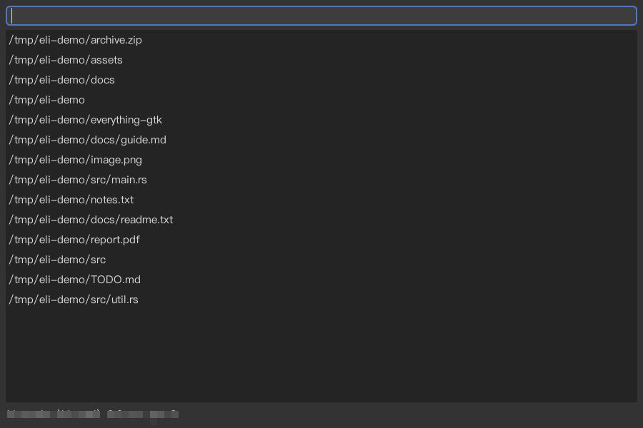
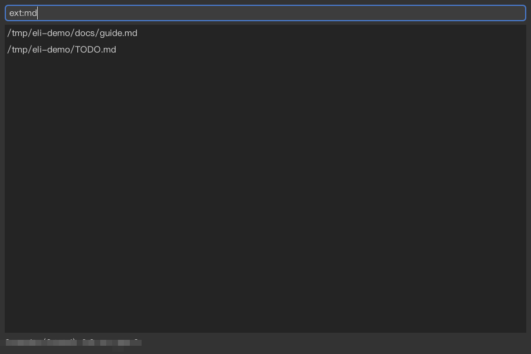
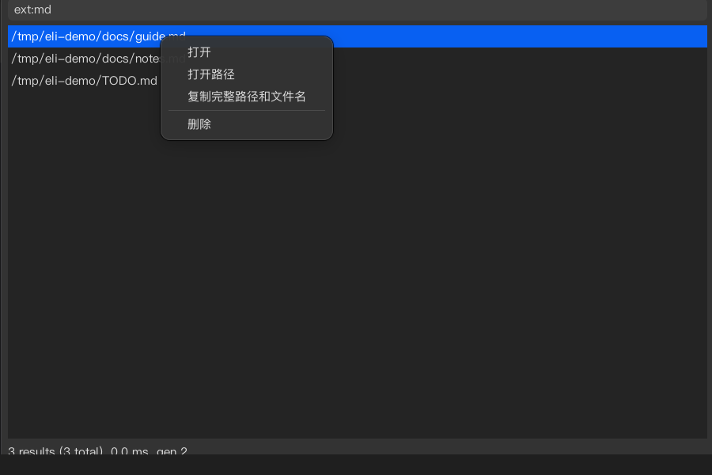

<div align="center">
  
  <h1>Everything-Linux</h1>
  <p><strong>Instant filename search for Linux</strong><br>
  A fused, single-process desktop app with an optional static CLI.</p>

  <p>
    <a href="https://github.com/sunjunior/Everything-Linux/releases/latest"></a>
    <a href="LICENSE"></a>
    <a href="https://www.rust-lang.org/"></a>
    <a href="https://github.com/sunjunior/Everything-Linux/actions"></a>
  </p>

  <p>
    <a href="README.md">English</a> |
    <a href="README.zh-CN.md">简体中文</a>
  </p>
</div>

---

Everything-Linux is a Linux filename search tool inspired by the “type and see results” experience of voidtools Everything. The index is kept in memory, updated by `inotify`, and persisted as a compact snapshot. The desktop app runs the indexer, query engine, and GTK3 UI in **one process**: no daemon, no IPC socket, and no helper binary to manage.

A standalone static CLI is also published for scripts and headless systems. It can query the index in-process with `--local`.

## Highlights

- **Million-file index** with near-instant, name-sorted results
- **Fused GUI**: indexing, querying, and `inotify` run inside `everything-gtk`
- **Live results**: file creation, deletion, and atomic replacement refresh the current query with a 250 ms debounce
- **Background root switch**: a new root is indexed while the old index keeps serving queries
- **Compact storage**: 48-byte entries, shared name pools, zstd snapshots
- **Query language**: substrings, `*`/`?`, regex, case/whole-word/path modes, AND/OR/NOT, parentheses
- **Attribute filters**: `size:`, `dm:`, `dc:`, `da:`, `ext:`
- **Desktop integration**: tray icon, single-instance window, context menu with open / open location / copy path / delete
- **Optional static CLI**: no GTK or daemon required; use `everything --local`

## Screenshots

Synthetic test data is used below. No real user paths or personal information are shown.

| Search results | Attribute filters | Result context menu |
|:---:|:---:|:---:|
|  |  |  |
| Type a filename pattern | `size:` / `dm:` / `ext:` filters | Open / open location / copy path / delete |

## Architecture

```text
[parallel walker] ─┐
                   ├─→ [Store: compact entries + name pools] ─→ [query engine]
[inotify monitor] ─┘              ▲                                  │
       ▲                          │ incremental updates              │
       │ debounce / overflow      └──────────────────────────────────┘
       │
[zstd snapshot] ←──────────────── [GUI: GTK3 + LocalEngine]

CLI: [everything] ─→ [LocalEngine --local]  (optional; no daemon)
```

The engine owns one compact index. Each entry is 48 bytes; names live in contiguous byte pools and directories are linked through `first_child` / `next_sibling`. `inotify` events update the index incrementally, and the GUI renders only the slots visible on screen. On a root change, a new engine is built in the background and swapped atomically while the old index continues answering queries.

## Download

Get the latest build from [GitHub Releases](https://github.com/sunjunior/Everything-Linux/releases/latest).

| Platform | GUI | Static CLI |
|---|---|---|
| Linux x86_64 | `everything-linux-x86_64.tar.gz` | `everything-cli-linux-x86_64.tar.gz` |
| Linux aarch64 | `everything-linux-aarch64.tar.gz` | `everything-cli-linux-aarch64.tar.gz` |
| Linux armv7 | `everything-linux-armv7.tar.gz` | `everything-cli-linux-armv7.tar.gz` |

Each GUI archive contains one `everything-gtk` binary (about 3.6 MB). It requires the system GTK3 runtime and is intended for desktop use. Each CLI archive contains one statically linked `everything` binary and does not require GTK or a daemon.

### Run the GUI

```bash
tar -xzf everything-linux-x86_64.tar.gz
./everything-gtk
```

### Run the CLI

```bash
tar -xzf everything-cli-linux-x86_64.tar.gz
./everything --local '*.rs'
```

`--local` opens the index in the CLI process and answers the query without IPC. The default socket mode needs a separate `everythingd`, which is not included in the CLI archive; scripts should pass `--local` explicitly.

## Build from Source

Requirements: Rust 1.85+ (edition 2024), Cargo, and GTK3 development headers for the GUI.

```bash
git clone https://github.com/sunjunior/Everything-Linux.git
cd Everything-Linux

cargo test
cargo build --release -p everything-gtk
# GUI: target/release/everything-gtk

cargo rustc --release -p everything -- -C target-feature=+crt-static
# CLI: target/release/everything
```

The release workflow builds Linux x86_64, aarch64, and armv7 assets. x86_64 and aarch64 run on native GitHub runners; armv7 is built in an ARM container under QEMU.

## Configuration

The GUI and CLI read `~/.config/everything-linux/config.toml`.

```toml
# Explicit roots. Multiple roots are supported.
roots = [
  "/home/you",
  "/mnt/archive",
]

# Keep explicit roots instead of following the executable directory.
auto_root = false

snapshot_path = "~/.cache/everything-linux/db.eldb"
socket_path = "/run/user/1000/everything-linux.sock"
watch_enabled = true
debounce_ms = 80
rescan_interval_secs = 600
snapshot_interval_secs = 5
threads = 8
max_results = 100000
```

If `roots` is empty, the app falls back to the directory containing the executable. When multiple explicit roots are configured, set `auto_root = false`; otherwise the executable directory will replace them.

## Query Examples

```bash
./everything --local '*.rs'
./everything --local '*.rs | *.md'
./everything --local '*.tmp !keep'
./everything --local 'size:>10mb'
./everything --local 'dm:>2025-01-01'
./everything --local 'ext:rs|md'
./everything --local --path 'projects/src'
./everything --local --json '*.toml' | jq .
```

## Performance

Measured on an Arch Linux x86_64 machine with 8 cores and 31 GiB RAM, indexing 1.06 million entries (940k files + 124k directories).

| Metric | Result |
|---|---:|
| Fused GUI RSS / PSS | 186.3 MB / 125.7 MB |
| GUI binary | 3.6 MB |
| zstd snapshot | about 25 MB |
| Cold index | 2.4–2.7 s |
| Background root rebuild | 2.4 s, query P95 16.4 ms |
| `*.rs` query | 8.9 ms (GUI status bar 10.6 ms) |
| `main.rs` query | 8.6 ms |
| Sort by size | 7.5 ms |
| `path:` query | 51.1 ms |

See [`docs/INPROCESS_BENCH.md`](docs/INPROCESS_BENCH.md) for the fused-engine benchmarks.

## Project Layout

```text
crates/
  everything_core/   engine, walker, query, monitor, persistence, LocalEngine, raw mmap prototype
  everythingd/       optional daemon for the CLI's socket mode
  everything/        optional CLI
  everything-gtk/    fused GTK3 GUI
docs/                benchmarks, inotify design, GUI/build and dependency notes
scripts/             dependency checks
build-static.sh      local static CLI/daemon build helper
```

## License

MIT OR Apache-2.0.
