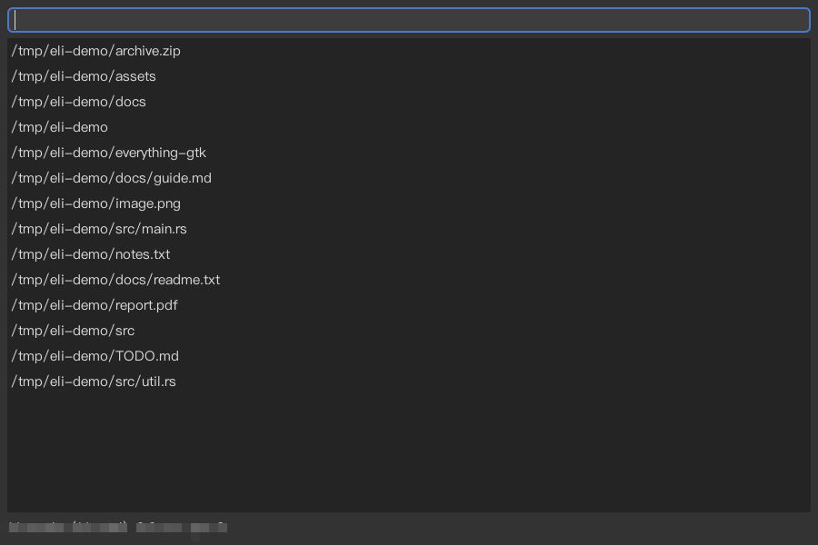
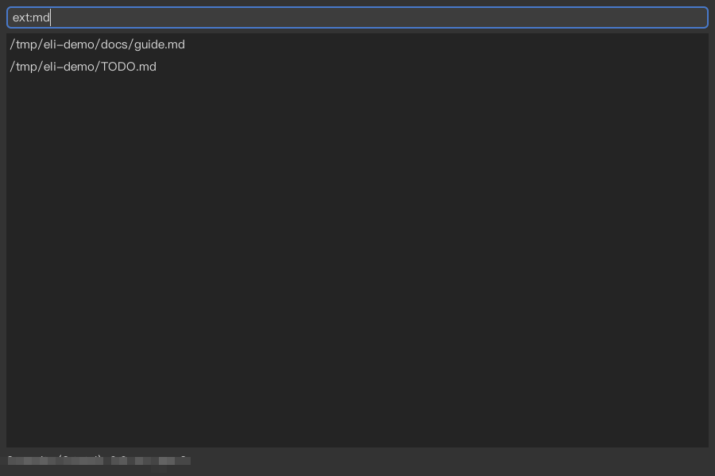
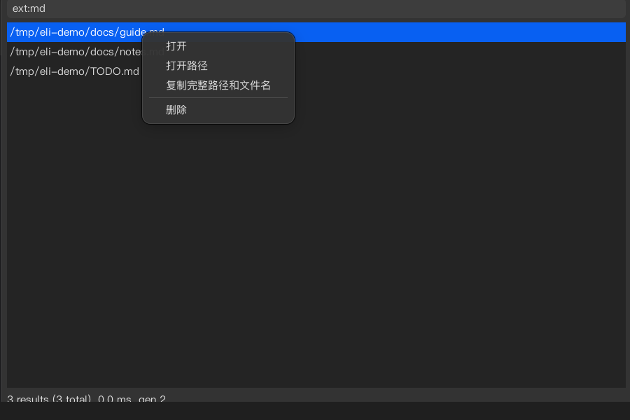

<div align="center">
  
  <h1>Everything-Linux</h1>
  <p><strong>Linux 上输入即出的文件名搜索工具</strong><br>
  单进程融合 GUI，另提供可选的静态 CLI。</p>

  <p>
    <a href="https://github.com/sunjunior/Everything-Linux/releases/latest"></a>
    <a href="LICENSE"></a>
    <a href="https://www.rust-lang.org/"></a>
    <a href="https://github.com/sunjunior/Everything-Linux/actions"></a>
  </p>

  <p>
    <a href="README.md">English</a> |
    <a href="README.zh-CN.md">简体中文</a>
  </p>
</div>

---

Everything-Linux 是一个 Linux 文件名搜索工具，目标是复刻 voidtools Everything “输入即出结果”的体验：索引常驻内存，通过 `inotify` 增量更新，并以紧凑快照持久化。桌面版把索引、查询引擎和 GTK3 界面放在**同一个进程**里，不需要 daemon、不需要 IPC socket，也没有额外的辅助二进制。

同时提供独立静态 CLI，适合脚本和无桌面环境；CLI 可以用 `--local` 在自身进程内完成查询。

## 特性

- **百万级文件名索引**，按名称排序时结果近乎即时
- **融合 GUI**：索引、查询、`inotify` 全在 `everything-gtk` 进程内运行
- **结果实时刷新**：文件新增、删除、原子替换后，250ms 防抖重跑当前查询
- **后台换根**：新根在后台建立索引，旧索引继续服务查询，完成后原子切换
- **紧凑存储**：48 字节条目、共享名字池、zstd 快照
- **查询语法**：子串、`*`/`?`、正则、大小写/全词/路径模式、AND/OR/NOT、括号
- **属性过滤**：`size:`、`dm:`、`dc:`、`da:`、`ext:`
- **桌面集成**：托盘图标、单实例窗口、右键菜单（打开 / 打开路径 / 复制完整路径 / 删除）
- **可选静态 CLI**：不依赖 GTK 和 daemon；使用 `everything --local`

## 界面预览

以下截图使用合成测试数据，不包含真实用户路径或个人信息。

| 搜索结果 | 属性过滤 | 结果右键菜单 |
|:---:|:---:|:---:|
|  |  |  |
| 输入文件名模式 | `size:` / `dm:` / `ext:` 过滤 | 打开 / 打开路径 / 复制完整路径 / 删除 |

## 软件架构

```text
[并行遍历] ────────┐
                    ├─→ [Store: 紧凑条目 + 名字池] ─→ [查询引擎]
[inotify 监听] ─────┘              ▲                        │
       ▲                            │ 增量更新                │
       │ 防抖 / 溢出兜底             └────────────────────────┘
       │
[zstd 快照] ←────────────────────── [GUI: GTK3 + LocalEngine]

CLI: [everything] ─→ [LocalEngine --local]  （可选，无 daemon）
```

引擎只维护一份紧凑索引。每条 `Entry` 固定 48 字节，名字存放在连续字节池中，目录通过 `first_child` / `next_sibling` 链访问。`inotify` 事件增量修改索引，GUI 只渲染当前可见行的 slot。换根时在后台构建新引擎，旧索引继续服务查询，完成后原子替换。

## 下载

最新版本见 [GitHub Releases](https://github.com/sunjunior/Everything-Linux/releases/latest)。

| 平台 | GUI | 静态 CLI |
|---|---|---|
| Linux x86_64 | `everything-linux-x86_64.tar.gz` | `everything-cli-linux-x86_64.tar.gz` |
| Linux aarch64 | `everything-linux-aarch64.tar.gz` | `everything-cli-linux-aarch64.tar.gz` |
| Linux armv7 | `everything-linux-armv7.tar.gz` | `everything-cli-linux-armv7.tar.gz` |

GUI 包只含一个约 3.6 MB 的 `everything-gtk`，需要系统 GTK3 运行库，适合桌面使用。CLI 包只含一个静态链接的 `everything`，不需要 GTK 或 daemon。

### 运行 GUI

```bash
tar -xzf everything-linux-x86_64.tar.gz
./everything-gtk
```

### 运行 CLI

```bash
tar -xzf everything-cli-linux-x86_64.tar.gz
./everything --local '*.rs'
```

`--local` 在 CLI 进程内打开索引并直接查询，不走 IPC。默认 socket 模式需要额外的 `everythingd`，CLI 包中没有包含；脚本场景请显式加 `--local`。

## 从源码构建

需要 Rust 1.85+（edition 2024）、Cargo；构建 GUI 还需要 GTK3 开发库。

```bash
git clone https://github.com/sunjunior/Everything-Linux.git
cd Everything-Linux

cargo test
cargo build --release -p everything-gtk
# GUI: target/release/everything-gtk

cargo rustc --release -p everything -- -C target-feature=+crt-static
# CLI: target/release/everything
```

发布流程会构建 Linux x86_64、aarch64、armv7 三套产物。x86_64、aarch64 使用原生 runner，armv7 在 QEMU 的 ARM 容器中构建。

## 配置

GUI 和 CLI 读取 `~/.config/everything-linux/config.toml`。

```toml
# 显式根路径；支持多个根
roots = [
  "/home/you",
  "/mnt/archive",
]

# 固定使用上面的 roots，不跟随可执行文件目录
auto_root = false

snapshot_path = "~/.cache/everything-linux/db.eldb"
socket_path = "/run/user/1000/everything-linux.sock"
watch_enabled = true
debounce_ms = 80
rescan_interval_secs = 600
snapshot_interval_secs = 5
threads = 8
max_results = 100000
```

`roots` 为空时，程序会回退到可执行文件所在目录。配置多个显式根时请设置 `auto_root = false`，否则可执行文件目录会覆盖这些根路径。

## 查询示例

```bash
./everything --local '*.rs'
./everything --local '*.rs | *.md'
./everything --local '*.tmp !keep'
./everything --local 'size:>10mb'
./everything --local 'dm:>2025-01-01'
./everything --local 'ext:rs|md'
./everything --local --path 'projects/src'
./everything --local --json '*.toml' | jq .
```

## 性能

环境：Arch Linux x86_64，8 核，31 GiB 内存；数据集 106 万条目（94 万文件 + 12.4 万目录）。

| 指标 | 结果 |
|---|---:|
| 融合 GUI RSS / PSS | 186.3 MB / 125.7 MB |
| GUI 可执行文件 | 3.6 MB |
| zstd 快照 | 约 25 MB |
| 冷索引 | 2.4–2.7 s |
| 后台换根重建 | 2.4 s，查询 P95 16.4 ms |
| `*.rs` 查询 | 8.9 ms（GUI 状态栏 10.6 ms） |
| `main.rs` 查询 | 8.6 ms |
| 按大小排序 | 7.5 ms |
| `path:` 查询 | 51.1 ms |

融合引擎的详细基准见 [`docs/INPROCESS_BENCH.md`](docs/INPROCESS_BENCH.md)。

## 工程结构

```text
crates/
  everything_core/   引擎、遍历、查询、监听、持久化、LocalEngine、raw mmap 原型
  everythingd/       CLI socket 模式使用的可选守护进程
  everything/        可选 CLI
  everything-gtk/    融合 GTK3 GUI
docs/                基准、inotify 设计、GUI/构建与依赖说明
scripts/             依赖检查
build-static.sh      本地静态 CLI/daemon 构建脚本
```

## 许可证

MIT OR Apache-2.0。
